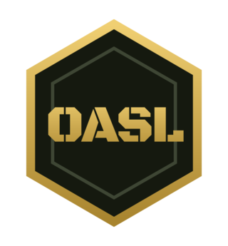

### Advanced Squad Leader in the browser, with every rule enforced by the engine.

**[Play at openasl.app](https://openasl.app)** · [Source](https://github.com/Open-ASL/open-asl) · [Discord](https://discord.gg/rNE3X32twS) · [YouTube](https://www.youtube.com/channel/UCAdltvkQODlUfHs7BmBP3GQ)

Open ASL is a free, non-commercial way to play **Advanced Squad Leader** and the **ASL Starter Kit** online.
The rules engine is the referee: it runs every phase, rolls every die, traces line of sight and only offers
the moves the rules allow. Play hotseat or live online, with After Action Reports for every game.

- **[open-asl](https://github.com/Open-ASL/open-asl)**: the game, the rules engine and the server. Source-available
  under the AGPL 3.0 with the Commons Clause.
- **Contribute:** bug reports, rules fixes and free scenarios are welcome. Start with the
  [contributing guide](https://github.com/Open-ASL/open-asl/blob/main/CONTRIBUTING.md).

Open ASL is not affiliated with Multi-Man Publishing or Hasbro. Advanced Squad Leader is a trademark of Hasbro, Inc., used under licence by Multi-Man Publishing.
